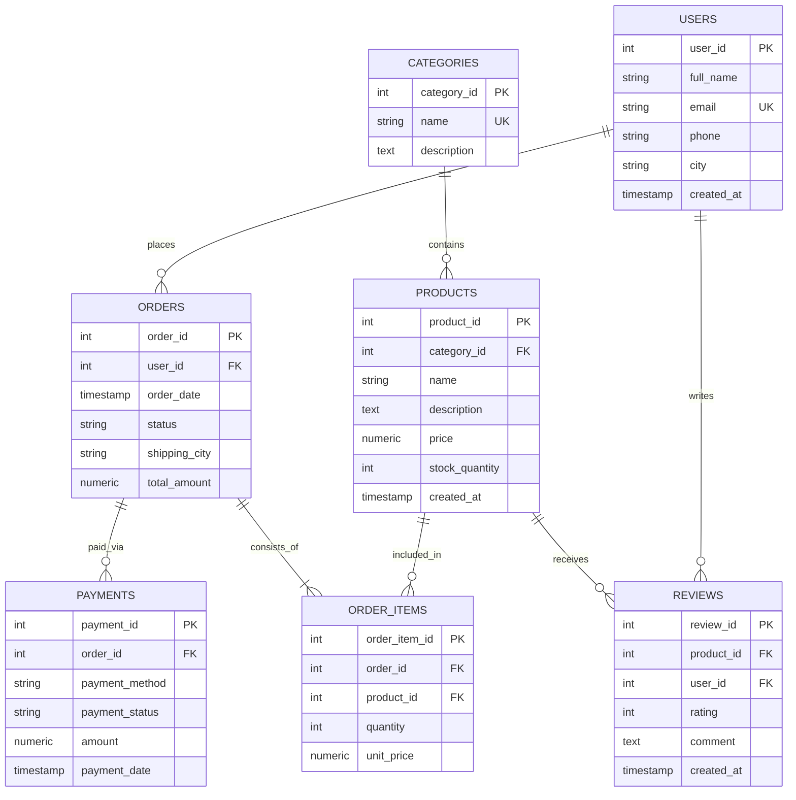

# Database ER Diagram & Normalization Notes

## 1. Entity Relationship (ER) Diagram (Mermaid.js)

---

## 2. Normalization Process (1NF to 3NF)

Is database schema ko normalize karne ke liye step-by-step 1NF se 3NF tak follow kiya gaya hai:

### First Normal Form (1NF)
* **Rule**: Table ke har cell me atomic (single) value honi chahiye aur duplicate repeating groups nahi hone chahiye. Har table me ek primary key honi chahiye.
* **Implementation**:
  * Pehle e-commerce me agar order table ke andar hi comma-separated products ya multiple items save karte toh 1NF violate hota.
  * Humne alag `order_items` table banaya jisme har row me strictly ek product aur uski quantity store hoti hai.
  * Sabhi tables me dedicated Primary Keys (`user_id`, `product_id`, `order_id`, etc.) set kiye gaye hain.

### Second Normal Form (2NF)
* **Rule**: Table 1NF me hona chahiye aur koi bhi **Partial Dependency** nahi honi chahiye (Non-key columns primary key ke subset par depend nahi karne chahiye).
* **Implementation**:
  * `order_items` table orders aur products ke beech ki junction/bridge table hai.
  * Agar hum `product_name` ya `category_name` ko `order_items` table me daal dete toh wo partial dependency hoti kyunki `product_name` sirf `product_id` pe depend karta hai, order pe nahi.
  * Isliye `order_items` me sirf `quantity` aur `unit_price` (at the time of purchase) rakha gaya hai jo composite concept (specific item in specific order) pe depend karta hai.

### Third Normal Form (3NF)
* **Rule**: Table 2NF me hona chahiye aur koi bhi **Transitive Dependency** nahi honi chahiye (Non-key column kisi doosre non-key column par depend nahi karna chahiye: A -> B, B -> C).
* **Implementation**:
  * **Categories separation**: `products` table me sirf `category_id` store hota hai. Category ka naam aur description `categories` table me hai taaki category name update karne par hazaron product rows modify na karni padein.
  * **Payments separation**: Order ka payment method aur payment status alag `payments` table me rakha gaya hai kyunki ek order ke multiple payment attempts ho sakte hain (jaise pehla FAILED hua, fir SUCCESS hua). Isse order table clean aur 3NF compliant rehta hai.
  * **Users vs Orders**: User ka phone number aur registration city `users` table me hai, jabki delivery address `orders.shipping_city` me hai (kyunki ek user doosri city me bhi order mangwa sakta hai).

---

## 3. Key Constraints & Indexing Strategy

1. **Foreign Key Constraints with Referential Actions**:
   * `orders.user_id` -> `ON DELETE CASCADE` (User delete hone par order history handle hoti hai).
   * `order_items.product_id` -> `ON DELETE RESTRICT` (Agar kisi product ke orders ban chuke hain toh accidental delete prevent hota hai).
   * `reviews.product_id` -> `ON DELETE CASCADE` (Product delete hone par uske reviews clean ho jaate hain).

2. **Check Constraints**:
   * `price >= 0` and `stock_quantity >= 0` (Negative pricing ya negative stock avoid karne ke liye).
   * `rating BETWEEN 1 AND 5` (Invalid star ratings prevent karne ke liye).
   * `status IN ('PENDING', 'PROCESSING', 'SHIPPED', 'DELIVERED', 'CANCELLED')` (Strict enum-like check).

3. **Performance Indexes**:
   * `idx_products_category_id` (Category filtering fast karne ke liye).
   * `idx_orders_user_id` (Customer order history fetch karne ke liye).
   * `idx_orders_order_date` (Time-series / monthly analytics queries ke liye).
   * `idx_order_items_order_id` & `idx_order_items_product_id` (JOIN operations ke execution speed boost karne ke liye).
