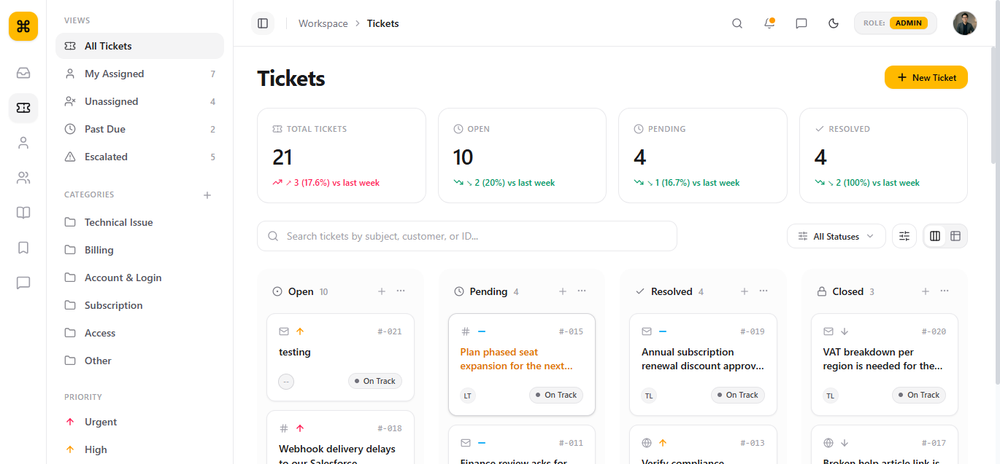
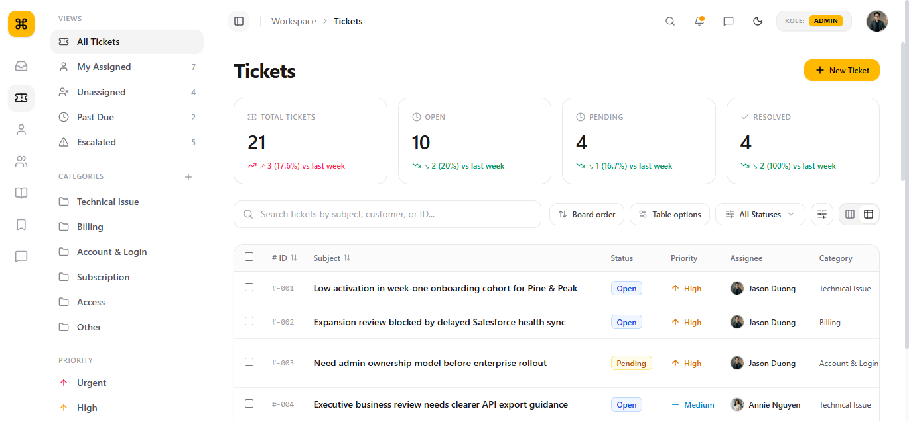
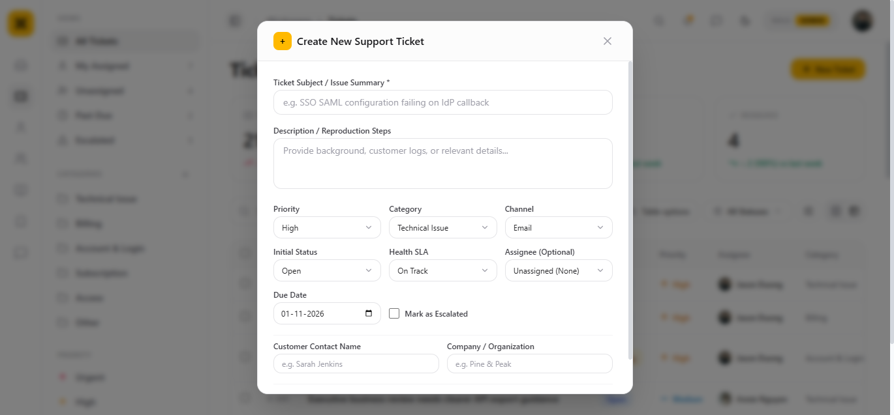
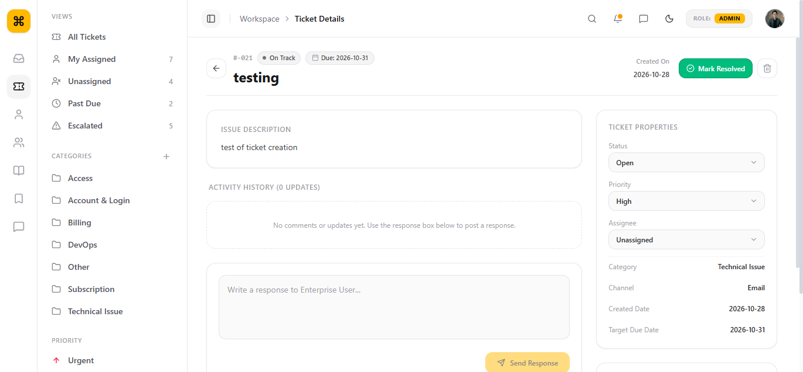
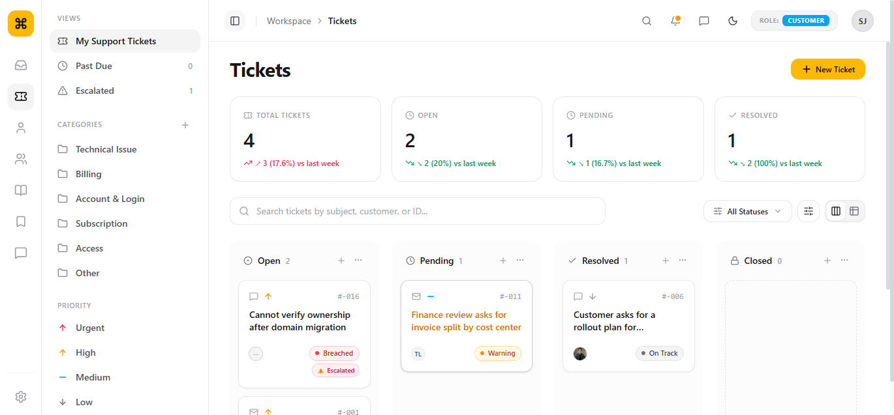
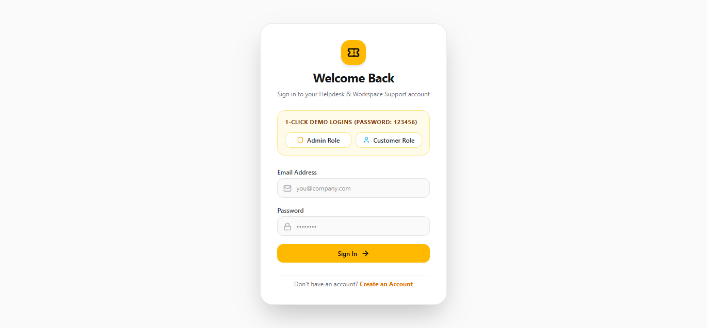
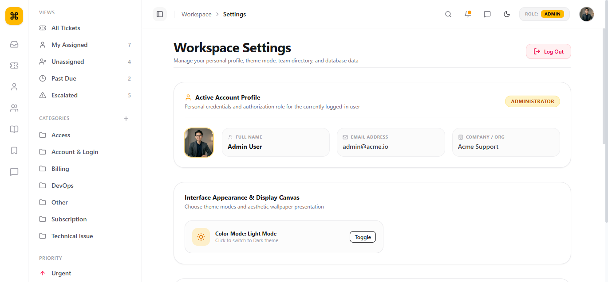
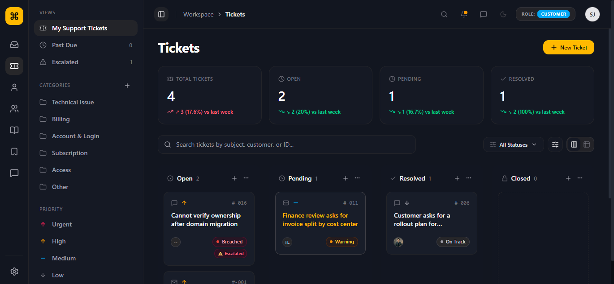

# 🎯 Helpdesk & Ticket Management System (TMS)

[](https://nextjs.org/)
[](https://react.dev/)
[](https://www.typescriptlang.org/)
[](https://tailwindcss.com/)
[](https://neon.tech/)
[](https://jwt.io/)

A modern, full-stack **Enterprise Helpdesk & Ticket Management System** designed for high-velocity customer support teams, workspace managers, and enterprise clients. Built with **Next.js 16 (App Router)**, **React 19**, **Neon Serverless PostgreSQL (Raw SQL)**, and **Tailwind CSS v4**, this application provides complete Role-Based Access Control (RBAC), interactive Kanban boards, tabular data views, SLA monitoring, and real-time database management.

---

## 📸 Visual Showcase & UI Gallery

Here is a look inside the actual user interface of the running application:

### 1. 📊 Interactive Kanban Board (Admin View)
*Dynamic multi-column workflow board with SLA indicators, category badges, assignee avatars, and column-aware quick ticket creation.*
<p align="center">
  
</p>

---

### 2. 📋 High-Density Table & List View
*Instant multi-column sorting, real-time debounced keyword search, SLA health tags, and full-fidelity ticket properties.*
<p align="center">
  
</p>

---

### 3. 🎫 Modern Ticket Creation Modal
*Pre-populates clicked Kanban column status, provides custom inset select arrows, team assignee dropdowns, and due date pickers.*
<p align="center">
  
</p>

---

### 4. 🔍 Individual Ticket Detail & Activity Timeline
*Comprehensive ticket inspection page displaying creation timestamp, SLA countdown, client company details, conversation history, and quick status resolutions.*
<p align="center">
  
</p>

---

### 5. 🛡️ Customer Portal (Role-Based Access Scoping)
*Strictly scoped view for enterprise clients: Customers only see tickets created by their company, can log new issues, and track progress without administrative clutter.*
<p align="center">
  
</p>

---

### 6. 🔐 Secure Authentication & 1-Click Demo Login
*Beautiful, branded login and signup portals featuring 1-click test credentials for instant evaluation.*
<p align="center">
  
</p>

---

### 7. ⚙️ Workspace Settings & 1-Click Database Reset
*User profile cards, support team roster, theme switcher, and instant PostgreSQL seed data restoration.*
<p align="center">
  
</p>

---

### 8. 🌙 Sleek Dark Mode Experience
*Built-in dark mode support tailored for night shifts and low-light workstation environments.*
<p align="center">
  
</p>

---

## ✨ Key Features & Capabilities

### 🛡️ Role-Based Access Control (RBAC)
- **Admin Role**:
  - Full visibility across all customer organizations and support queues.
  - Ability to change ticket statuses, assign engineers, update priorities, and delete tickets.
  - Access to team member directory and one-click database seed restoration.
- **Customer Role**:
  - **Scoped Data Isolation**: Customers can only view tickets belonging to their own organization.
  - **Safe Privileges**: Customers can submit new support tickets and monitor live resolution progress. Deletion and assignee assignment controls are protected.
- **Next.js Middleware Guard (`middleware.ts`)**:
  - All dashboard routes (`/tickets`, `/analytics`, `/customers`, `/settings`, `/inbox`) require active authentication. Unauthenticated requests are immediately redirected to `/login`.

### 🗄️ Neon Serverless PostgreSQL Backend (Zero Heavy ORMs)
- **Raw SQL Architecture**: Powered directly by the Node `pg` client using clean parameterized SQL queries (`$1, $2, ...`) to prevent SQL injection.
- **Beginner-Friendly & Maintainable**: No convoluted ORM abstractions (like Prisma or Drizzle) — every query is explicit, clear, and thoroughly commented.
- **Automated Schema Provisioning**: Database tables (`users`, `categories`, `tickets`, `ticket_comments`) are automatically verified and initialized upon server launch.

### 📋 Dual Workspace Views (Kanban & Table)
- **Kanban Board**:
  - 4 Status Lanes: `Open`, `Pending`, `Resolved`, and `Closed`.
  - Column-aware `+` action button automatically pre-selects the lane status in the creation modal.
  - Live metric chips indicating weekly delta trends.
- **High-Density Table View**:
  - Comprehensive listing with sortable column headers (# ID, Subject, Status, Priority, Assignee, Category, Channel, Health SLA).

### ⏱️ SLA Health & Escalation Engine
- **Health Indicators**: Real-time SLA categorization tags:
  - 🟢 `On Track`
  - 🟡 `Warning`
  - 🔴 `Breached`
  - ⚠️ `Escalated`
- **Audit Timestamps**: Exact ticket creation dates and SLA resolution targets displayed prominently on every ticket.

### 🎨 Custom UI / UX Details
- **Unified Custom Alerts & Modals**: Built to match the amber/slate design language, eliminating abrupt browser native alerts.
- **Refined Select Inputs**: Native dropdown arrows replaced with clean, properly inset `ChevronDown` icons with balanced right padding.
- **Theme Support**: Effortlessly toggle between light and dark themes with persistent user preferences.

---

## 🛠️ Technology Stack

| Layer | Technologies Used |
| :--- | :--- |
| **Framework** | [Next.js 16 (App Router)](https://nextjs.org/) with Turbopack |
| **Frontend UI** | [React 19](https://react.dev/), [Tailwind CSS v4](https://tailwindcss.com/), [Lucide React](https://lucide.dev/) |
| **Backend & APIs** | Next.js API Routes (Node.js runtime) |
| **Database** | [Neon PostgreSQL](https://neon.tech/) (Serverless Cloud Postgres) via `pg` driver |
| **Authentication** | [JSON Web Tokens (JWT)](https://jwt.io/) stored in secure HTTP-only cookies, [Bcrypt.js](https://github.com/dcodeIO/bcrypt.js) |
| **Type Safety** | [TypeScript 5](https://www.typescriptlang.org/) |

---

## 🚀 Getting Started & Setup Guide

Follow these steps to run the Ticket Management System locally:

### 1. Prerequisites
Ensure you have the following installed on your machine:
- **Node.js**: `v18.17.0` or higher (Node 20+ recommended)
- **npm** or **yarn** or **pnpm**
- A **Neon PostgreSQL** database connection URL (or local PostgreSQL instance)

---

### 2. Clone & Navigate to the Project
```bash
# Navigate to the Week-4 Ticket Management System directory
cd "Week-4/Ticket Management System"
```

---

### 3. Install Dependencies
```bash
npm install
```

---

### 4. Configure Environment Variables
Create a `.env` file in the root of `Week-4/Ticket Management System` (or duplicate `.env.example`):

```bash
cp .env.example .env
```

Open `.env` and configure your credentials:
```env
# Neon Serverless PostgreSQL Connection String
DATABASE_URL=postgresql://neondb_owner:<your-password>@<your-neon-host>.neon.tech/neondb?sslmode=require

# Secret Key for Signing JWT Authentication Tokens
JWT_SECRET=super_secure_jwt_secret_key_change_in_production_12345
```

> **Security Note:** Never commit `.env` containing live database passwords or production secrets to Git. The `.gitignore` file already excludes `.env`.

---

### 5. Seed the Database
Populate your database with the complete dataset (including admins, enterprise customer accounts, categories, and initial support tickets):

```bash
node scripts/seed.cjs
```

*Alternatively, you can also click the **"Restore PostgreSQL Seed Data"** button directly inside `/settings` after logging in as an Admin.*

---

### 6. Run the Development Server
```bash
npm run dev
```

Open your browser and navigate to:
```
http://localhost:3000
```
*(Unauthenticated users will automatically be redirected to `http://localhost:3000/login`)*

---

### 7. Production Build (Optional)
To verify or run an optimized production build:

```bash
# Build the production bundle
npm run build

# Start the production server
npm start
```

---

## 🔑 Default Demo Accounts

For fast evaluation, 1-Click login buttons are available directly on the `/login` screen. All seed accounts use the default password: `123456`.

### 👑 Administrator Accounts (Full Workspace Privileges)
| Name | Email | Role | Company | Default Password |
| :--- | :--- | :--- | :--- | :--- |
| **Admin User** | `admin@acme.io` | Admin | Acme Support | `123456` |
| **Jason Duong** | `jason.duong@acme.io` | Admin | Acme Support | `123456` |
| **Annie Nguyen** | `annie.nguyen@acme.io` | Admin | Acme Support | `123456` |
| **Nhi Pham** | `nhi.pham@acme.io` | Admin | Acme Support | `123456` |
| **Thanh Le** | `thanh.le@acme.io` | Admin | Acme Support | `123456` |
| **Lam Tran** | `lam.tran@acme.io` | Admin | Acme Support | `123456` |
| **Bao Truong** | `bao.truong@acme.io` | Admin | Acme Support | `123456` |
| **Michael Huang**| `michael.huang@acme.io`| Admin | Acme Support | `123456` |

### 🏢 Customer Accounts (Scoped Organization Privileges)
| Name | Email | Role | Company | Default Password |
| :--- | :--- | :--- | :--- | :--- |
| **Sarah Jenkins** | `customer@client.com` | Customer | Pine & Peak Inc. | `123456` |
| **Marcus Vance** | `m.vance@vancetech.io` | Customer | Vance Logic | `123456` |
| **Elena Rostova** | `elena@novasystems.de` | Customer | Nova Systems | `123456` |
| **Brian Thorne** | `brian@sentinelguard.com`| Customer | Sentinel Guard | `123456` |
| **Aaliyah Patel**| `aaliyah@crestline.org` | Customer | Crestline Corp | `123456` |

---

## 📂 Project Architecture & Directory Structure

```text
Week-4/Ticket Management System/
├── app/                              # Next.js App Router Pages & API Endpoints
│   ├── api/                          # Serverless API Handlers
│   │   ├── auth/                     # Authentication Routes (login, signup, me, logout)
│   │   ├── categories/               # Category management API
│   │   ├── seed/                     # 1-Click Database restoration endpoint
│   │   ├── tickets/                  # Ticket CRUD & comment handling APIs
│   │   └── users/                    # Support team & user directory API
│   ├── analytics/                    # Analytics & SLA reporting page
│   ├── customers/                    # Organizations & customer directory page
│   ├── inbox/                        # Team inbox / triage route (Coming Soon)
│   ├── login/                        # Authentication login screen
│   ├── settings/                     # User profile, team roster & DB controls
│   ├── signup/                       # New customer / admin registration
│   ├── tickets/                      # Kanban & Table views
│   │   ├── [id]/                     # Dedicated individual ticket view & timeline
│   │   └── new/                      # Standalone full-page ticket creation form
│   ├── globals.css                   # Tailwind CSS v4 styling rules
│   ├── layout.tsx                    # Root application HTML shell & context wrapper
│   └── page.tsx                      # Root index route (redirects to /tickets)
│
├── components/                       # Modular UI Components
│   ├── layout/                       # Shell components (Header, Sidebar, IconRail, AppShell)
│   ├── tickets/                      # Ticket cards, NewTicketModal, TicketModal, TableView
│   └── ui/                           # Reusable UI elements (Custom alerts, buttons, inputs)
│
├── lib/                              # Core Utilities & Backend Services
│   ├── db/                           # Neon PostgreSQL connection pool & schema creation
│   │   └── db.ts                     # Raw SQL query wrapper with security parameters
│   ├── auth.ts                       # JWT verification & password hashing helpers
│   ├── mock-data.ts                  # Baseline mock structures & type defaults
│   └── ticket-context.tsx            # Global state context for tickets, filters & theme
│
├── public/                           # Static Web Assets
│   ├── images/                       # Team avatars & wallpaper assets
│   └── screenshots/                  # High-resolution screenshots of the application
│
├── scripts/                          # Database Automation Scripts
│   ├── raw_seed_data.txt             # Plaintext list of user emails & roles
│   └── seed.cjs                      # Automated PostgreSQL table setup & data seeder
│
├── middleware.ts                     # Next.js Edge Middleware for Route Protection
├── .env.example                      # Sample environment variables template
├── package.json                      # Project dependencies & npm run scripts
├── tsconfig.json                     # TypeScript compiler configuration
└── readme.md                         # Comprehensive project documentation
```

---

## 💡 Developer Guidelines & Code Style

- **Beginner-Friendly Syntax**: Code avoids unnecessary complexity or obscure syntactic sugar; every file features comprehensive comments explaining the *why* behind implementation decisions.
- **Raw SQL over ORM**: Direct queries with parameterized values ensure students and junior developers understand core relational database concepts without magic layers.
- **Separation of Concerns**: UI rendering is kept strictly decoupled from database queries via Next.js REST API routes.
- **Zero Exposed Secrets**: All connection credentials and cryptographic keys are loaded exclusively through server-side environment variables.

---

## 📄 License
This project was created for educational, training, and internship purposes under the **MxiCoders Training & Internship Program (Week 4)**. Feel free to modify and expand upon it for learning and portfolio purposes.

